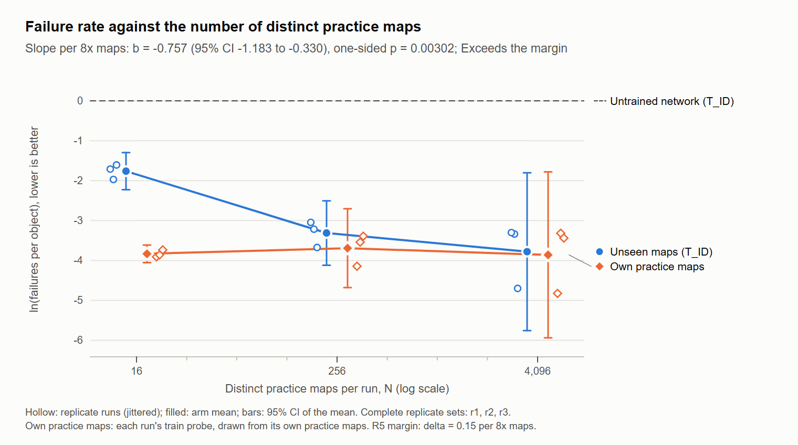

# Practice diversity in a pixel-input osu! agent

Author: James Liu

Project: **osu-lab**. Software distribution: **osu-sim**; Python import: **osu_sim**.

**Software.** osu-sim, a GPU simulator of osu!standard gameplay: a port of the game's judgement rules, a renderer
of the agent's 256 x 192 view and a PPO trainer (a median of 9,143 decisions per second on one consumer GPU in this
study). Agents play from pixels, setting the cursor and two keys 60 times per second.

**The question.** At a fixed training budget, does practising on more distinct procedurally generated maps lower an
agent's failure rate on maps it has never seen?

**The study (Study PD).** Nine agents trained from scratch for 60 million decisions each on 16, 256 or 4,096 distinct
generated maps, three replicates per arm (the pre-registered fallback design, chosen by a pilot rule before the
freeze). Smaller pools are prefixes of larger ones, so arms differ in how many distinct maps they see and so in how
often each is repeated. The outcome is the log failure rate (combo breaks plus missed slider ends per combo object) on
500 unseen maps of the same generator, plus two shifted sets (a 1.3x faster tempo; burst drills never practised as
such).

**Protocol safeguards.** The design, analysis code and every input file were frozen and
hashed before any study run, and two independent RFC 3161 timestamping authorities signed the hash list. The test maps
were generated afterwards from a seed derived from both timestamp tokens and were played once. The analysis and its
outcome categories were written and tested on synthetic data before any result existed.

**Result.** Agents that practised on more distinct maps failed less often on unseen maps: along the fitted line,
failures per object fell by about 53% per 8x more maps (95% CI 28% to 69%; one-sided p = 0.003), past the
pre-registered margin for a practically meaningful effect. Descriptively, most of the gain came between 16 and 256 maps. With 16 maps
the agents played their own practice maps far better than new ones, and that gap shrank with more maps. The advantage
held on the faster maps but not clearly on the unpractised drills, and the replicates differed a lot.

*Lower is better; hollow points are the nine agents, filled points the arm means with 95% intervals.*

**Data.** Every map was procedurally generated from recorded seeds; no community-made beatmaps were used.

**Limitations.** One generator; generated maps only (no claim about human-made maps); three replicates, with a p-value
that depends on the pre-registered error term; one recipe and budget; more maps also meant fewer repetitions of each;
a cursor that can jump anywhere in one step.

**Review and access.** Internal review exceeded the preregistered three-round cap; the owner retrospectively approved D1.
This is not external peer review. This public derivative accompanies the report and its exported evidence; source
handover files are preserved. Renderer assets and gameplay media are excluded.

**License.** CC BY 4.0 for rights held by James Liu; changes from the accepted handover are identified in the companion source release. The license and font notices are attached to this PDF.
