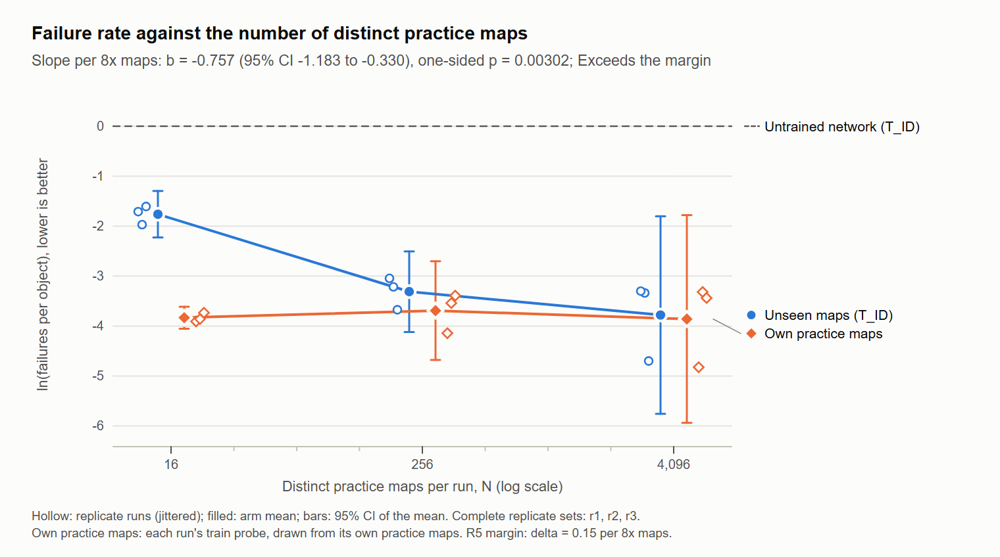
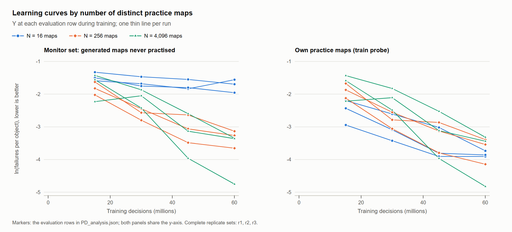
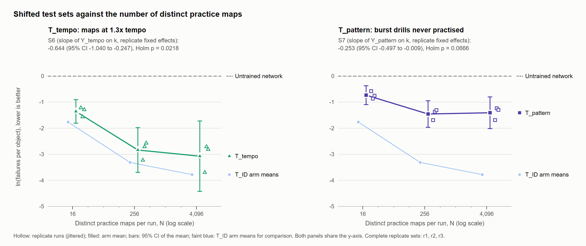

# Practice diversity and generalization in a pixel-input osu! agent: a pre-registered study on procedurally generated maps

Author: James Liu

Project: **osu-lab**. Software distribution: **osu-sim**; Python import: **osu_sim**.

## Abstract

Agents trained with reinforcement learning often master the situations they practise and fail on new ones. This
report asks, in a pre-registered study, how the number of distinct procedurally generated practice maps changes a
pixel-input agent's failure rate in osu!, a rhythm game that demands precise aim and timing. It presents osu-sim, a
GPU simulator of osu!standard gameplay whose judgement rules were reported to match the real game engine step for step on scripted
traces of generated maps, and a protocol in which the design was frozen and timestamped by two independent
authorities before any study run and the sealed test maps were generated afterwards from a seed derived from those
timestamps. Nine agents were trained from scratch for 60M decisions each on 16, 256 or 4,096 distinct generated maps,
three replicates per arm. On 500 unseen maps of the same construction, failures per object fell by about 53% per 8x
more maps along the fitted line (slope -0.757 in log failures per object; 95% CI -1.183 to -0.330; one-sided
p = 0.003), which exceeds the pre-registered margin; descriptively, most of the gain came between 16 and 256 maps. The advantage held
on maps with a 1.3x faster tempo; on a drill family never practised as such, it was not significant after correction. All
maps were generated, and the study makes no claim about human-made maps.

## 1 Introduction

Agents trained with reinforcement learning often master the exact situations they practise and fail on new ones.
Procedurally generated training content is a standard way to measure and reduce this gap: when the training levels
are drawn from a generator, the number of distinct levels becomes a controlled variable, and performance on fresh
levels from the same generator measures generalization rather than memorization [zhang2018study;
cobbe2019quantifying; cobbe2020leveraging; justesen2018illuminating; risi2020increasing; kirk2023survey].

osu! is a rhythm game in which the player moves a cursor onto circles and sliders and presses a key at the right
moment. It asks for millisecond timing and precise aiming from what is on the screen. That makes it a useful test bed
for pixel-input control in the tradition of game benchmarks for reinforcement learning [bellemare2013arcade;
machado2018revisiting]: an agent must read the playfield from pixels, anticipate objects from their approach circles,
and act at 60 decisions per second. Rhythm games have been used as reinforcement-learning environments before
[ferrerfilho2021gym]; here the game's own judgement rules are reproduced and checked against the game engine.

This report makes three contributions.

1. **osu-sim**, a GPU simulator of osu!standard gameplay with a renderer of the agent's view and a PPO trainer
   [schulman2017proximal] that trained at a median of 9,143 decisions per second on one consumer GPU in this study
   (section 2).
2. **A protocol** for small confirmatory studies: a pre-registration frozen before any study run, two RFC 3161 trusted
   timestamps [adams2001internet], sealed test sets whose generator seed is derived from those timestamp tokens (so the test
   maps could not exist when the design was fixed), a once-only test batch and pre-registered outcome categories
   (section 3).
3. **Study PD**, which asks: at a fixed training budget, how does the number of distinct procedurally generated
   practice maps change a pixel-input agent's failure rate on unseen generated maps, in distribution and under two
   shifts? Nine agents were trained from scratch: three arms (16, 256 and 4,096 distinct maps) times three
   replicates, the pre-registered fallback design that a pilot rule selected before the freeze (sections 4 and 5).

Every map used for training, evaluation or testing in this report was procedurally generated from recorded seeds;
no community-made beatmap was used (section 7).

## 2 osu-sim

osu-sim runs many osu!standard episodes in parallel on one machine and exposes them to a reinforcement-learning
trainer, in the spirit of batched GPU emulators for game-playing agents [dalton2020accelerating]. Its rules follow a
pinned build of the open-source game client, osu!lazer release 2026.921.0 [ppy2026osu].

- **Rules.** A vectorised port of the judgement rules of a pinned osu!lazer version, compiled with numba and run on the
  CPU in parallel over environments. Each decision is a 60 Hz step: the agent's cursor move and key presses and
  releases are applied at the start of the step, presses go to the earliest hovered unjudged circle or slider head,
  and the rules then advance in 1 ms sub-updates to the next decision, judging hits (Great, Ok, Meh, Miss), slider
  ticks, repeats and ends, and spinners.
- **Renderer.** A Triton GPU kernel draws the agent's view: a 256 x 192 RGB frame of the playfield in the game's
  default (Argon) style, with approach circles, sliders, follow points and spinners in the game's draw order. Each
  output pixel integrates the scene over its exact footprint in a 960 x 720 client image, so frames match a
  downscaled screenshot of the game's presentation; rendering is a pure function of the state (bit-identical
  re-renders).
- **Agent interface.** Observations are the rendered frames; actions are an absolute cursor position and two keys,
  60 times per second. Episodes are short clips of 8 to 32 objects during training and whole maps from time zero during
  evaluation.
- **Trainer.** PPO [schulman2017proximal] with 1,024 parallel environments, 128-step rollouts, a recurrent policy
  over a convolutional encoder, and parameter moving averages (EMA) for evaluation. In this study the nine runs
  trained at a median of 9,143 decisions per second (run medians 8,883 to 9,746) on one consumer GPU, so each
  60M-decision run took under two hours.
- **Fidelity.** The rules were checked against the real game engine on generated maps: 72 scripted input traces on 10
  seeded generated maps (four general maps and six spinner-heavy maps), replayed both in osu-sim and in the pinned
  osu!lazer build through an instrumented host, agreed step for step in all 72 cases (77,323 steps, no mismatched
  step; equal per-type judgement totals, maximum combo and episode length), at normal speed and at the Double Time
  rate. The package's 107 conformance tests, which regenerate those maps byte for byte and re-simulate the recorded
  totals, passed in the earlier release validation; the tested code and fixtures are unchanged here. The comparison covers judgement counts, combo and timing of episodes; it does not cover accuracy,
  score or positions, and those traces contain no missed slider ticks, slider ends or spinners. On two held-out
  generated maps the rendered frames differ from the game's own frames by a mean foreground error of 1.23 and 1.34
  levels out of 255 (3,541 frames): close, but not pixel-exact. These are historical
  measurements recorded in the exported kit facts, not a new renderer validation. Native per-step
  traces, comparison frames and the renderer assets are omitted; this release checks retained judgement
  aggregates and cannot independently repeat those frame or per-step comparisons.

## 3 Protocol

The study follows a fixed sequence, adapted from pre-registration practice [nosek2018preregistration] to the needs
of reinforcement learning, where results vary strongly between seeds and few runs are affordable [henderson2018deep;
agarwal2021deep]. Each step leaves a file whose hash later steps check.

1. **Pilot, then freeze.** A labelled exploratory pilot set the training budget by a rule written down in advance
   (section 4). The pre-registration was then frozen: written once to a new file and never edited. Its SHA-256, and
   the SHA-256 of every pool, configuration, queue file and analysis script, went into one timestamp manifest.
2. **Trusted timestamps.** Two independent timestamping authorities (DigiCert and Sectigo) signed the manifest's
   SHA-256 digest under RFC 3161 [adams2001internet]. Only the digest and a random nonce left the computer. Both tokens were
   verified with OpenSSL against the authorities' certificate chains. A token proves that the manifest, and so every
   file it hashes, existed no later than the time the authority signed.
3. **Test sets that could not exist earlier.** The sealed test maps were generated only after both tokens verified,
   from a seed derived from the tokens themselves: s = the first 8 bytes of SHA-256(DigiCert token bytes followed by
   Sectigo token bytes), read as an integer, and test map j uses generator seed 5,000,000 + (s mod 4,000,000) + j.
   Nobody, including the experimenter, could know these maps when the design was frozen, so the design cannot have
   been tuned to them. The test maps' hashes were checked to be disjoint from every training pool before they were
   written, and every test file was registered (path and SHA-256) in a sealed registry that the trainer and the queue
   refuse to load.
4. **Training under guards.** A queue launched the runs one at a time in a pre-registered order, refused any pool
   outside the practice pools, refused launches after a fixed cut-off time, and stopped a run on non-finite values or
   policy-ratio drift (one labelled rerun allowed per run for a numerical fault).
5. **One test batch.** After training, a batch tool created a use-event file before reading any sealed file and
   refuses to run if that file exists, so the test sets are played once. It verified the final checkpoints' and the
   test pool's hashes, then let every final policy play the same merged test pool.
6. **Pre-registered analysis and outcome categories.** The analysis script was written and tested on synthetic data
   before any result existed. The primary result is reported in one of five pre-registered categories that combine
   the one-sided test with a practical margin delta, in the manner of equivalence and minimum-effect testing
   [lakens2017equivalence] (table in section 4); only "Exceeds the margin" may be called practically meaningful.
7. **Internal review.** The results document was checked in internal review rounds, each covering numbers and
   provenance, statistics, claims against the pre-registration, clean-data and protocol compliance, readability, and a
   skeptic's reading; this was not external or peer review. The pre-registration allowed at most three rounds, and none
   of the first three was free of major findings (the third found one major wording problem), so the review continued
   until the fifth round found no major problem. The review therefore did not keep the pre-registered three-round cap:
   that is the study's one deviation from the pre-registration (D1), recorded in a dated deviations file
   ([exported D1 record](../evidence/study/PD_DEVIATIONS_2026-11-01.md)) and accepted retrospectively by the owner on
   2026-11-01. It changes no number.

## 4 Study PD design

**Question.** At a fixed training budget, how does the number of distinct procedurally generated practice maps change
a pixel-input agent's failure rate on unseen generated maps, in distribution and under two shifts?

**Maps.** Every map is produced by the project's generator from a seed: a scalar difficulty level in [0, 1] sets the
tempo, approach rate, timing windows, circle size, spacing, rhythm divisions and the chances of sliders, spinners and
streams; a variant override then makes a slider drill, spinner drill, stream/jump drill or plain map. Positions in a
replicate's sequence of 8,192 maps get a difficulty band (three bands, shares 0.21 / 0.35 / 0.44) and a variant (shares
0.25 / 0.15 / 0.10 / 0.50) by sequential quotas, so every prefix of the sequence has the same mix within one map, and a
level drawn evenly inside its band.

**Budget gate G0 and the design in force.** A pilot (exploratory, not part of the study) trained on a separate
replicate's 8,192 maps for 40M decisions and was evaluated on a 200-map monitor set at 10M, 20M, 30M and 40M. The
rule, written before the pilot finished: train every study run for 30M decisions if the monitor accuracy of the
averaged policy reached 0.85 at 30M, for 40M if it reached 0.85 at 40M; otherwise, if it reached at least 0.75 at
40M, use a fallback design with fewer, longer runs (three arms times three replicates at 60M decisions). The pilot's
averaged policy reached 0.8206 at 30M and 0.8446 at 40M, so the fallback applied, as the rule states (appendix D).

**Arms and replicates.** Three arms, N = 16, 256 and 4,096 distinct practice maps, each 16 times the previous; with
k = log8(N / 16) = 0, 4/3 and 8/3, a slope in k is still the change per 8 times more maps. Three replicates; each
draws a fresh map sequence (its own generator seeds) and uses its own training seed. Within a replicate the pools are
nested: the 16-map pool is the first 16 maps of the 256-map pool, which is the first 256 of the 4,096-map pool, so
arms differ only in how many distinct maps are seen, not in which kind.

**Training.** Every run starts from scratch and trains for the same budget, D = 60M decisions, with the same frozen
recipe: a convolutional encoder over the agent's 60 Hz pixel view, a recurrent policy, PPO with 1,024 parallel
environments, and a parameter moving average (EMA, decay 0.9999) whose final value is the evaluated policy. The nine
configurations differ from the recipe only in the seed, the pool, the budget and the evaluation list, which a
mechanical diff checks (appendix B). The runs trained one at a time in a pre-registered Latin-square order (each
replicate's three arms in a rotated order), so no arm systematically trained earlier or later.

**Test sets.** Drawn after the freeze from the token-derived seed (section 3): T_ID, 500 maps of the practice
construction (the primary); T_tempo, 250 maps of the upper two bands generated with the tempo raised 1.3 times
(approach time and hit windows unchanged; their tempos overlap the practised range); and T_pattern, 250 burst drills (runs of quarter-beat notes, stacks and kick
sliders), a drill family that no run practised as such (practice maps also contain quarter-beat streams, but not this
drill structure). The three sets
were merged into one pool in a fixed order, and every final policy played that identical file, deterministically.
Each run also played its own first min(N, 256) practice maps (the train probe) to measure memorization.

**Outcome.** For a set of maps, F is the number of failures (combo breaks plus missed slider ends) and O the number of
combo-bearing judgements (circles, slider heads, ticks, repeats and ends, spinners). The outcome is Y = ln(F / O),
the log failure rate; lower is better. The memorization gap is G = Y(T_ID) - Y(train probe).

**Analysis.** The primary model is an ordinary least-squares fit Y(T_ID) = alpha_r + b k with one intercept per
replicate; H1 predicts b < 0 (more distinct maps, fewer failures on unseen maps), tested one-sided at 0.05. The
estimate is reported with 95% and 90% intervals and one of five outcome categories with a practical margin of
delta = 0.15 per 8x step (about a 14% change in the failure rate):

| Outcome | Rule (p from the one-sided test; 90% CI) |
|---|---|
| Exceeds the margin | p < 0.05 and the 90% CI lies entirely beyond +delta or entirely beyond -delta |
| Detectable difference, magnitude uncertain | p < 0.05, and the CI neither lies inside +-delta nor entirely beyond it |
| Detectable but within the margin | p < 0.05 and the 90% CI lies inside +-delta |
| Equivalent within the margin | p >= 0.05 and the 90% CI lies inside +-delta |
| Inconclusive | p >= 0.05 and the CI is not inside +-delta |

Six secondary tests, Holm-corrected [holm1979simple], each one-sided in the predicted direction: 16 versus 4,096 maps
and the two adjacent steps (paired by replicate), the slope of the memorization gap, and the slopes on T_tempo and
T_pattern. Only complete replicate sets (all three arms finished) count, and all three replicates are needed.

## 5 Results

All nine runs reached the budget on their first attempt, with no rerun or stop and every launch before the cut-off,
and the test batch ran once. Throughout, Y is the natural log of failures per combo object; lower is better.

**Primary result (H1).** Agents trained on more distinct practice maps failed less often on unseen maps of the same
construction (figure 1). The pre-registered slope is b = -0.757 per 8x more maps (95% CI -1.183 to -0.330; one-sided
p = 0.003; df = 5; nine runs in three complete replicate sets; interval and p under the pre-registered error term, see
below). Along the fitted line, failures per object fell by
about 53% per 8x more maps (95% CI 28% to 69%). The whole 90% interval (-1.091 to -0.423) lies further from zero than
the margin delta = 0.15, so the outcome category is **Exceeds the margin**, the only category that may be called
practically meaningful. That 90% interval excludes slopes between -0.15 and zero and positive slopes; the category
says nothing more about how large the slope is.

*Figure 1. Y on unseen in-distribution maps (T_ID, blue) and on each run's own practice maps (orange; for 4,096 maps
its first 256), against the number of distinct practice maps. Hollow points are the nine runs; filled points are arm
means with 95% intervals; the lines join arm means (the fitted line of the primary is not drawn). Dashed: the
untrained network.*

**What the estimate rests on.** With three equally spaced arms and one baseline per replicate, the slope equals the
16-versus-4,096 contrast divided by 8/3, so the 256-map runs do not move the estimate; they enter only its error term.
The same contrast judged by replicate-to-replicate variation alone (S1 below) has a one-sided p of 0.033 before
correction and an interval that includes zero, and it is not significant after Holm. The residual SD of the primary
fit (0.541) was larger than every value in the pre-registered precision table (largest 0.40). Exploratory checks, not
pre-registered: leaving out any one replicate, the slope stays negative with a one-sided p below 0.05 and a 90%
interval beyond the margin; with a replicate-level error term, the 90% interval still lies just beyond the margin. The
direction and the outcome category hold in every check; the p-value of 0.003 depends on the pre-registered error term.

**Secondary results.** Six tests, Holm-corrected, each one-sided in the predicted direction (table 1). S1 to S3
compare two arms within each replicate (a difference in Y); S5 to S7 are slopes per 8x more maps, fitted like the
primary. The intervals are per test, two-sided and not adjusted.

| Test | Estimate | 95% CI | Holm p | After Holm |
|---|---|---|---|---|
| S1: 4,096 vs 16 maps (difference in Y) | -2.018 | -4.347 to 0.312 | 0.067 | not significant |
| S2: 256 vs 16 maps (difference in Y) | -1.550 | -2.668 to -0.432 | 0.054 | not significant |
| S3: 4,096 vs 256 maps (difference in Y) | -0.468 | -1.679 to 0.744 | 0.119 | not significant |
| S5 (H2): slope of the memorization gap G | -0.746 | -1.099 to -0.394 | 0.009 | significant |
| S6 (H3): slope on T_tempo | -0.644 | -1.040 to -0.247 | 0.022 | significant |
| S7 (H4): slope on T_pattern | -0.253 | -0.497 to -0.009 | 0.067 | not significant |

*Table 1. Secondary tests.*

| Distinct practice maps | Y on T_ID | Y on own practice maps | Gap G | Y on T_tempo | Y on T_pattern | Accuracy on T_ID |
|---|---|---|---|---|---|---|
| 16 | -1.763 | -3.833 | 2.071 | -1.356 | -0.729 | 0.765 |
| 256 | -3.313 | -3.692 | 0.379 | -2.836 | -1.454 | 0.899 |
| 4,096 | -3.780 | -3.861 | 0.081 | -3.073 | -1.404 | 0.916 |

*Table 2. Arm means over three replicates; intervals, per-replicate values and tables by difficulty band and map
variant are in the exported [aggregate analysis](../evidence/study/PD_analysis.json), under
`descriptive` and `runs`. The historical results document `PD_RESULTS_r5.md`, accepted after internal review
under deviation D1, is not included.*

The pre-registered tests are the primary slope and the six secondary tests in table 1. The points below are
descriptive unless one of those tests is named; exploratory checks and post-hoc analyses are labelled as such.

- **Unequal steps.** In every replicate both steps lowered Y on T_ID, and the step from 16 to 256 maps was the larger
  one. As paired mean changes, failures per object fell by about 79% from 16 to 256 maps and by about 37% from 256 to
  4,096 maps (each a 16x step); neither step is significant on its own after Holm. Spinner-drill maps did not improve
  from 16 to 256 maps, unlike slider, stream/jump and plain maps, and improved at 4,096 maps mainly through replicate
  1's agent.
- **Memorization (H2, supported).** With 16 maps the agents played their own practice maps far better than unseen
  maps (gap 2.071); the gap shrank to 0.379 with 256 maps and 0.081 with 4,096. Play on own practice maps was similar
  on average across arms, so the gap closed because play on unseen maps improved; H2 mostly restates H1.
- **A speed-up (H3, supported under the pre-registered error term).** On maps of the two harder bands generated with
  a 1.3x faster tempo, the slope was -0.644 (figure 3). These tempos overlap the practised range, so this shows that the advantage held under a speed-up,
  not play beyond every practised tempo.
- **A drill family never practised as such (H4, not supported).** On burst drills every arm stayed far worse than on
  in-distribution maps, and no run completed any drill without a failure. Every 256-map and 4,096-map run had fewer
  failures there than every 16-map run, with no further gain beyond 256 maps, but the slope (-0.253) is not
  significant after Holm: the data neither establish nor exclude a benefit.
- **Replicates.** Replicate 1's 4,096-map agent (Y -4.699 on T_ID) was far better than the other two (-3.339 and
  -3.302). Post hoc, it was the only agent that completed every spinner: spinner-drill maps account for nearly half of
  its advantage in failures over the other two, it still leads clearly on the other maps, and completing spinners did
  not follow the number of maps. Because the slope rests on the 16-versus-4,096 contrast, this enters the estimate; in
  an exploratory check, leaving replicate 1 out still gives a slope beyond the margin.
- **Training curves (figure 2).** On average the 4,096-map runs were still improving steeply when the budget ended,
  the 256-map runs more slowly, and the 16-map runs slowly throughout; the advantage of more maps grew during training. The
  results describe one budget.
- **References.** A scripted autopilot that knows every object's position and time in advance played the whole test
  pool without a failure; the untrained network failed every object.

*Figure 2. Y during training (four evaluations per run) on the 200-map monitor set (generated maps never practised)
and on own practice maps; one line per run.*

*Figure 3. T_tempo (left; S6, significant after Holm) and T_pattern (right; S7, not significant after Holm; the panel
title's "never practised" means never practised as such); faint: the T_ID arm means, which differ from T_tempo in
difficulty bands as well as tempo.*

**Demo omitted.** The source handover describes a video of replicate 1's 16-map and 4,096-map agents side by side on the first map of each
difficulty band of the monitor set, with a running failure count. The pairing was fixed in the pre-registration
before any result. Replicate 1's 4,096-map agent is the best of the three 4,096-map agents on the test set, so the
source video shows a larger contrast than the arm means. It illustrates the result and is not evidence for it.
The video and its supporting media files are excluded because renderer texture and font permissions are unresolved;
no demo is needed to inspect the exported aggregate results.

## 6 Limitations

- **Generated maps only.** All training and test maps come from one procedural generator (`osu_sim.generator`). The
  results say how practice diversity matters within that generator's distribution, a speed-up of the same
  construction and a drill family made by the same code base; they do not show how agents would do on human-made
  beatmaps, whose patterns are richer and more varied.
- **One generator.** Diversity here means more seeds of the same generator, not more generators or styles. The
  pattern-shift set (burst drills) comes from a different routine of the same code base.
- **An absolute cursor.** The agent sets the cursor position directly at every 60 Hz step, so it can move the cursor
  any distance in one step. Human players cannot, so aiming is easier for the agent than for a person, and its play
  is not a model of human play.
- **Star ratings do not apply.** The generated maps carry a pseudo-difficulty (0.5 + 4.5 x level) used for sampling.
  It is not an osu! star rating and must not be compared with ratings of real maps.
- **Small replicate count.** Three replicates per arm; the primary inference is over replicates (residual
  df = 5). The outcome category says where the 90% interval lies relative to the margin, not how precise the estimate
  is, and the p-value depends on the pre-registered error term (section 5).
- **Three arms, one budget.** The pilot rule selected the fallback design, so the arms are 16, 256 and 4,096 maps
  (not the planned four arms up to 8,192) at 60M decisions per run.
- **One training recipe.** The recipe and budget are fixed (pre-registration sections 2 and 7); the effect of map
  diversity could differ at other budgets, model sizes or hyperparameters.
- **More maps meant fewer repetitions of each.** At a fixed budget a 16-map run practised each map in thousands of
  training clips and a 4,096-map run each map in about twenty, while the total practice per run was nearly equal. The
  design cannot separate the effect of diversity from the effect of repeating each map less, and larger pools also
  sample the practised tempo range more fully. The recipe was fixed before this study and not tuned for it, in
  particular not for pools as small as 16 maps.
- **An uneven curve.** The straight line in log N summarises three arms; descriptively, most of the gain came between 16 and 256
  maps, and the shape of the curve was not a pre-registered test.
- **The averaged policy.** With the recipe's warm-up schedule the parameter average never reached its nominal decay
  within the budget and weights the last quarter of training most, so arms still improving fast at the end are
  evaluated somewhat behind their final weights. This lag probably works against H1; whether averaging itself favours
  an arm was not measured.
- **One deterministic pass on one drawn test set.** Each agent played each test map once, always taking its most
  likely action; the intervals reflect training replicates only, not which test maps were drawn. The own-practice
  pools differ in size, which affects the memorization gap by an unknown amount.
- **Simulator coverage.** The fidelity traces contain no missed slider ticks, slider ends or spinners, so the
  simulator's counting of these failures, all of which the failure count includes, was not compared with the game;
  the spinner findings in section 5 therefore describe the simulator's spinner rules. The accuracy the tables report
  was not validated against the game either.

## 7 Data statement

Every map used in this report for training, evaluation or testing was procedurally generated by `osu_sim.generator`
from seeds recorded in a manifest: the practice pools (`runs/sim/pools/pd_v1/`), the monitor set and the sealed test
sets (`runs/sim/pools/sealed_pd/`). No community-made beatmap was used, and no model trained on community-made
beatmaps was loaded, evaluated or cited. A clean-data audit checks this mechanically (appendix C).

## References

The bibliography is included as [references.bib](references.bib). The source handover records checks on
2026-11-01; the original verification log is omitted. The release-specific
[reference audit](../evidence/documents/REFERENCE_AUDIT.json) records each checked primary source and any
verification limits. Bibliographic citations do not grant rights to reproduce third-party works.

- [adams2001internet] C. Adams, P. Cain, D. Pinkas, R. Zuccherato (2001). Internet X.509 Public Key Infrastructure
  Time-Stamp Protocol (TSP). RFC 3161. doi:10.17487/RFC3161.
- [agarwal2021deep] R. Agarwal, M. Schwarzer, P. S. Castro, A. Courville, M. G. Bellemare (2021). Deep Reinforcement
  Learning at the Edge of the Statistical Precipice. NeurIPS 34, 29304-29320.
- [bellemare2013arcade] M. G. Bellemare, Y. Naddaf, J. Veness, M. Bowling (2013). The Arcade Learning Environment: An
  Evaluation Platform for General Agents. JAIR 47, 253-279. doi:10.1613/jair.3912.
- [cobbe2019quantifying] K. Cobbe, O. Klimov, C. Hesse, T. Kim, J. Schulman (2019). Quantifying Generalization in
  Reinforcement Learning. ICML 2019, PMLR 97, 1282-1289.
- [cobbe2020leveraging] K. Cobbe, C. Hesse, J. Hilton, J. Schulman (2020). Leveraging Procedural Generation to
  Benchmark Reinforcement Learning. ICML 2020, PMLR 119, 2048-2056.
- [dalton2020accelerating] S. Dalton, I. Frosio (2020). Accelerating Reinforcement Learning through GPU Atari
  Emulation. NeurIPS 33, 19773-19782.
- [ferrerfilho2021gym] R. F. Férrer Filho, Y. L. B. Nogueira, C. A. Vidal, J. B. Cavalcante-Neto, P. B. S. Serafim
  (2021). Gym Hero: A Research Environment for Reinforcement Learning Agents in Rhythm Games. SBGames 2021, 87-96.
  doi:10.1109/SBGames54170.2021.00020.
- [henderson2018deep] P. Henderson, R. Islam, P. Bachman, J. Pineau, D. Precup, D. Meger (2018). Deep Reinforcement
  Learning That Matters. AAAI 32(1). doi:10.1609/aaai.v32i1.11694.
- [holm1979simple] S. Holm (1979). A Simple Sequentially Rejective Multiple Test Procedure. Scandinavian Journal of
  Statistics 6(2), 65-70.
- [justesen2018illuminating] N. Justesen, R. Rodriguez Torrado, P. Bontrager, A. Khalifa, J. Togelius, S. Risi
  (2018). Illuminating Generalization in Deep Reinforcement Learning through Procedural Level Generation. NeurIPS 2018
  Deep Reinforcement Learning Workshop. arXiv:1806.10729.
- [kirk2023survey] R. Kirk, A. Zhang, E. Grefenstette, T. Rocktäschel (2023). A Survey of Zero-shot Generalisation in
  Deep Reinforcement Learning. JAIR 76, 201-264. doi:10.1613/jair.1.14174.
- [lakens2017equivalence] D. Lakens (2017). Equivalence Tests: A Practical Primer for t Tests, Correlations, and
  Meta-Analyses. Social Psychological and Personality Science 8(4), 355-362. doi:10.1177/1948550617697177.
- [machado2018revisiting] M. C. Machado, M. G. Bellemare, E. Talvitie, J. Veness, M. Hausknecht, M. Bowling (2018).
  Revisiting the Arcade Learning Environment: Evaluation Protocols and Open Problems for General Agents. JAIR 61,
  523-562. doi:10.1613/jair.5699.
- [nosek2018preregistration] B. A. Nosek, C. R. Ebersole, A. C. DeHaven, D. T. Mellor (2018). The preregistration
  revolution. PNAS 115(11), 2600-2606. doi:10.1073/pnas.1708274114.
- [ppy2026osu] ppy Pty Ltd (2026). osu! (osu!lazer), release 2026.921.0-lazer, commit aaa75b7.
  https://github.com/ppy/osu/releases/tag/2026.921.0-lazer.
- [risi2020increasing] S. Risi, J. Togelius (2020). Increasing generality in machine learning through procedural
  content generation. Nature Machine Intelligence 2(8), 428-436. doi:10.1038/s42256-020-0208-z.
- [schulman2017proximal] J. Schulman, F. Wolski, P. Dhariwal, A. Radford, O. Klimov (2017). Proximal Policy
  Optimization Algorithms. arXiv:1707.06347.
- [zhang2018study] C. Zhang, O. Vinyals, R. Munos, S. Bengio (2018). A Study on Overfitting in Deep Reinforcement
  Learning. arXiv:1804.06893.

## Appendix A. Pre-registration and timestamps

All times are 2026-11-01, UTC. The paths and hashes in this appendix identify historical study records
under `runs/development/pd_20261101/`; the timestamp tokens, manifest, ledger, registry and pools are not
public downloads. Their reported metadata is retained in [kit facts](../evidence/study/kit_facts.json) and the
recorded audit. This export does not independently authenticate the omitted timestamp tokens or sealed inputs.

| Event | Time (UTC) | Evidence |
|---|---|---|
| Pre-registration frozen; timestamp manifest written (100 hashed files) | 10:23:25 | `PD_PREREG_frozen_2026-11-01_0223.md`, `timestamp_manifest.json` |
| DigiCert RFC 3161 token, "Verification: OK" | 10:23:32 | `ledger/tsa/digicert.tsr` |
| Sectigo RFC 3161 token, "Verification: OK" | 10:23:33 | `ledger/tsa/sectigo.tsr` |
| Sealed test sets drawn from the token-derived seed (both tokens re-verified first) | 10:23:41 | `ledger/pd_draw_event.json`, `sealed_registry_pd.json` |
| First study run launched | 10:27:19 | `pd_queue_log.jsonl` |

| File | SHA-256 |
|---|---|
| `PD_PREREG_frozen_2026-11-01_0223.md` | `048098da3e0d246b0abfdf2da92c0483fe5f0a2f75b437c329be200da55af30f` |
| `timestamp_manifest.json` (the digest both authorities signed) | `0f1d692fa6981fcd39010d77c48c14af894147797fe47e7c638339becb66dfb2` |
| `ledger/tsa/digicert.tsr` | `45d877f7a1c1bbaf52a1c3319b4dd25c0aa6512369dca79676f4d56368f5999e` |
| `ledger/tsa/sectigo.tsr` | `5a725884b37e0e99624428b81e2138304471f280adec54c57c59a663b65d9942` |
| `sealed_registry_pd.json` | `9806242d973fde9565ff05c4f9f0a831e430ee86035793edaedac67fc0df072c` |
| `runs/sim/pools/sealed_pd/pd_test_all.npz` (1,000 maps) | `dd357b9d514516e0c9638b46123992069dde5c49ec97d6ddebec509a9d6e7e29` |

With the omitted original tokens, manifest and CA chain, the historical verification procedure is: `openssl ts -verify -data timestamp_manifest.json -in digicert.tsr -CAfile <CA bundle>`, which prints
"Verification: OK", and `openssl ts -reply -in digicert.tsr -text` for its time. The test seed is
s = int.from_bytes(SHA-256(digicert.tsr bytes followed by sectigo.tsr bytes)[:8], "big"); test map j has generator
seed 5,000,000 + (s mod 4,000,000) + j.

## Appendix B. Configuration differences from the recipe

Names below are original study identifiers, not exported file paths. The exact frozen recipe, configurations and
queue are omitted; the portable package configuration is a reproduction aid, not that frozen environment.
The exported kit facts and aggregate records retain the settings reported here.

Every study configuration equals the frozen recipe `runs/sim/configs/pkg_recipe_r1.json` (SHA-256
`851b5da9db406873ec9ac62b475dfdd561c4daaea26e2f55aa2d8c5ddd485e37`) except in the keys below; a mechanical diff with
an allowlist (`make_pd_configs.py check`) verified this before the freeze. Every run: `max_decisions` = 60,000,000;
`eval_at` = 15M, 30M, 45M and 60M; evaluations on `pd_monitor_v1` and on the train probe, both with EMA 0.9999,
deterministic, hit animations off; a run-specific `_note`.

| Config | `seed` | `env.pool` (practice maps) | Train probe |
|---|---|---|---|
| `pd_n16_r1` | 1 (recipe value) | `pd_r1_n16` (16) | `pd_r1_n16` |
| `pd_n256_r1` | 1 (recipe value) | `pd_r1_n256` (256) | `pd_r1_n256` |
| `pd_n4096_r1` | 1 (recipe value) | `pd_r1_n4096` (4,096) | `pd_r1_n256` |
| `pd_n16_r2` | 2 | `pd_r2_n16` (16) | `pd_r2_n16` |
| `pd_n256_r2` | 2 | `pd_r2_n256` (256) | `pd_r2_n256` |
| `pd_n4096_r2` | 2 | `pd_r2_n4096` (4,096) | `pd_r2_n256` |
| `pd_n16_r3` | 3 | `pd_r3_n16` (16) | `pd_r3_n16` |
| `pd_n256_r3` | 3 | `pd_r3_n256` (256) | `pd_r3_n256` |
| `pd_n4096_r3` | 3 | `pd_r3_n4096` (4,096) | `pd_r3_n256` |

## Appendix C. Clean-data audit

The audit (`clean_data_audit.py`, whose SHA-256 is pinned in the pre-registration) ran after the test batch and the
demo; its handover output is [CLEAN_DATA_AUDIT_HANDOVER.json](../evidence/study/CLEAN_DATA_AUDIT_HANDOVER.json),
verdict **PASS**, with no failed row. A later documented final audit is also retained as
[CLEAN_DATA_AUDIT_FINAL.json](../evidence/study/CLEAN_DATA_AUDIT_FINAL.json). Both are unchanged recorded
outputs; the audit script, raw inputs and demo records are omitted and the audit was not rerun for this release. It checks four
things.

- **Pools.** Every pool named by a configuration of this study, by the test batch or by the demo has a build manifest
  from this study whose SHA-256 equals the pool file's and which lists the generator seed of every map: the practice
  pools, the monitor set, the pilot pool and the merged test pool.
- **Runs.** Every run of this study (the pilot, a short tooling smoke run and the nine study runs) was launched
  without resume, initialisation or growth options, and its training log starts at the first update.
- **Records.** No configuration, launch record or log of this study names a human-map dataset, a pool directory other
  than the generated ones, or a checkpoint from outside this study.
- **Order.** The sealed draw came after both timestamp tokens, the tokens after the freeze, the first study launch
  after the freeze and the draw, and every study launch before the cut-off.

The trainer's own exposure counters agree: every decision of every run was on maps labelled procedural. The demo's
records, which the audit's record scan does not cover, were checked by hand in the internal review: they name only the monitor set
and the two final checkpoints of replicate 1, with the hashes recorded before the test batch.

## Appendix D. Pilot (exploratory)

The pilot trained the same recipe from scratch on a separate replicate's 8,192 generated maps (replicate 0, training
seed 0) for 40M decisions and was evaluated on the 200-map monitor set (`pd_monitor_v1`, never trained on). It is
disclosed in the pre-registration and never pooled with the study. "EMA" is the averaged policy that gate G0 reads;
"raw" is the current network.

| Decisions | EMA accuracy | EMA failures per object | Raw accuracy | Raw failures per object | Wall time (s) |
|---|---|---|---|---|---|
| 10,092,544 | 0.6147 | 0.1834 | 0.7083 | 0.1623 | 1,177.0 |
| 20,054,016 | 0.7747 | 0.1287 | 0.7027 | 0.2087 | 2,326.2 |
| 30,015,488 | 0.8206 | 0.1187 | 0.8208 | 0.1301 | 3,475.6 |
| 40,108,032 | 0.8446 | 0.0875 | 0.8647 | 0.0702 | 4,639.7 |

Gate G0 (written before the pilot finished): 30M decisions if EMA accuracy >= 0.85 at 30M; 40M if >= 0.85 at 40M;
otherwise the fallback F1 (three arms 16, 256, 4,096; three replicates; 60M decisions) if >= 0.75 at 40M. The EMA
accuracy was 0.8206 at 30M and 0.8446 at 40M, so F1 applied. The raw network passed 0.85 at 40M, but the rule reads
the averaged policy, the one every study result uses; it was applied unchanged. Each study run's `--max-hours` limit
(3.1 h) is 1.5 times the pilot's 40M wall time extrapolated to 60M, plus 0.2 h.

## Public-release evidence and document scope

This document is an editorial derivative of the current study handover, whose original bytes are preserved.
[Document provenance](../evidence/documents/DOCUMENT_PROVENANCE.json) records the original and exported identities,
editorial changes and semantic evidence mapping. Confirmatory estimates come from the accepted aggregate analysis;
exploratory sensitivity, spinner and exposure statements also use the narrowly selected
[exploratory evidence receipt](../evidence/study/EXPLORATORY_RECEIPT.md). Raw evaluations and training logs are omitted.
The report preserves the distinction between preregistered tests, descriptive observations and exploratory checks.
The internal review exceeded the preregistered three-round cap; the owner retrospectively approved D1.

Project engineering and integration are distinct from upstream ports of osu! and osu-framework behavior.
The release does not claim invention of those rules, PPO or standard statistical methods. See the
[third-party notices](../THIRD_PARTY_NOTICES.md). The public project is osu-lab; the simulator distribution remains osu-sim. Author: James Liu.
The owner-held rights in this derivative and the exact study text/chart scope use CC BY 4.0 under
[LICENSE-STUDY.md](../LICENSE-STUDY.md); factual records use the separate CC0 scope. The applied
[study inventory](../evidence/study/LICENSE_PROPOSAL.json) separates approved source hashes from exported hashes.

**Personal contribution (James Liu).** I developed and integrated a reinforcement-learning system for procedurally generated osu! maps, and designed and ran a study of how practice-map diversity affects generalization. The system adapts upstream osu! and osu-framework rules and uses established PPO and recurrent-network methods.
