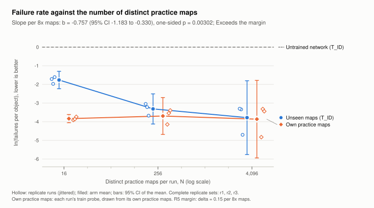

# Study PD: accepted procedural result

This is a release-authored summary of the existing accepted Study PD results. It is not the original report or a rewritten frozen record. The original selected JSON and deviation records in `evidence/study/` are copied byte-for-byte. Owner-approved rights are applied through the exact sidecar inventories; publication still requires a separate instruction.

## Question and completed design [STUDY-001]

At a fixed budget, does practice on more distinct procedural maps reduce failures on unseen maps from the same generator? The completed preregistered fallback F1 used pools of 16, 256 and 4,096 maps, three replicate sets and a target budget of 60 million decisions per run. All nine runs passed completeness checks; none was excluded. Within each replicate, practice pools were nested. Y is the natural logarithm of failures per combo-scoring object; lower is better. Failures include combo breaks and missed slider ends. A zero-failure outcome uses ln(0.5 / object count).

## Primary result [RESULT-001]

The fitted slope was **-0.757 log-failure units per 8x increase in practice-map count**, with a 95% confidence interval of **[-1.183, -0.330]** and one-sided **p = 0.003**, under the preregistered classical OLS error term. The fit uses replicate fixed effects, nine runs and five residual degrees of freedom. The 90% interval is [-1.091, -0.423]; the preregistered outcome category is **“Exceeds the margin”**, using a margin of 0.15 per 8x. That category refers to this study's specified margin, not a claim of human-level skill or broad practical usefulness.

[FIG-001] Hollow markers show individual replicate runs; filled markers and bars show arm means and 95% t-intervals across replicates. Lines connect arm means, not the fitted primary slope. The own-practice probe uses all maps for the smaller arms and the first 256 for the 4,096-map arm. The primary slope and its conditional interval are reported in the subtitle. Keep this caption and the limitations with the figure.

The interval is conditional on the specified classical OLS model. It is not a confidence interval over human-created beatmap distributions.

## Secondary family [RESULT-002]

Six one-sided tests were corrected together using Holm's method. The intervals below are individual two-sided intervals, without multiplicity adjustment.

| Contrast or slope | Estimate | 95% CI | Holm p | Reject after Holm |
|---|---:|---|---:|---|
| S1: 4096 minus 16, paired Y difference | -2.018 | [-4.347, 0.312] | 0.067 | No |
| S2: 256 minus 16, paired Y difference | -1.550 | [-2.668, -0.432] | 0.054 | No |
| S3: 4096 minus 256, paired Y difference | -0.468 | [-1.679, 0.744] | 0.119 | No |
| S5: unseen-minus-practice gap, slope per 8x | -0.746 | [-1.099, -0.394] | 0.009 | Yes |
| S6: tempo-shift outcome, slope per 8x | -0.644 | [-1.040, -0.247] | 0.022 | Yes |
| S7: burst-drill outcome, slope per 8x | -0.253 | [-0.497, -0.009] | 0.067 | No |

S1–S3 use paired replicate errors with two degrees of freedom; S5–S7 use the preregistered classical OLS error term with five degrees of freedom. S6 significance depends on that error model.

The burst-drill test did not meet the family-wise rejection criterion. An individual interval excluding zero does not override the corrected p-value. No confirmatory claim about a particular pair of arms follows from the primary trend alone.

## Interpretation and limits

The evidence is confined to one procedural generator, one training recipe and one budget. More distinct maps also meant fewer repetitions per map. The design does not separate those effects. There are only three independent replicate sets; the classical error term pools variation across runs within those sets. For this equally spaced F1 design, the primary slope equals 3/8 of the S1 endpoint contrast. S1 uses paired replicate uncertainty and its 95% interval includes zero. This shows why the error model matters; it does not replace the preregistered primary test. The straight-line slope averages unequal observed gains, and the arms are 16x apart although slope units are per 8x. It does not establish an indefinitely continuing scaling law.

The cursor is absolute and can cross the playfield in one action. Generator difficulty labels are not native star ratings. Finite generated conformance records do not validate every simulator failure mode, and retained native per-step events are unavailable. No claim about community maps, human motor control, native spinner grades or pixel-exact rendering is supported. [ENG-002, FID-001, FID-002, DATA-001]

## Review, provenance and access [REVIEW-001]

The existing study record accepts revision r5 after a full fifth round covering six review lenses, with no major findings and required fixes rechecked. **Deviation D1:** the review continued beyond the preregistered cap of three rounds. The unchanged dated deviation record is included. The owner retrospectively approved D1 and accepted r5 as the final internally reviewed results document. The approved record is included in this revision. Do not call this journal peer review or independent human certification.

The final clean-data audit is PASS with `dry_run=false`; it is the existing 20:31:52 output identified in the completion log. We read its completed record without rerunning its audit or opening pools. Its source paths are historical identifiers, not invitations or dependencies for public verification.

Read `../evidence/study/STUDY_PROVENANCE.json` for the selected original identities and the omitted originals' historical hashes. `PD_analysis.json` retains stale planned-design prose in `settings.labels`; use its actual `settings.arms`, `settings.replicates`, `settings.holm_m`, `complete_replicates`, `primary` and `secondary` fields for F1. No source labels were rewritten.

Run `python tools/verify_claims.py` and `python tools/verify_study.py` from the extracted source root. The checks resolve only exported evidence, verify identities, compare semantic claim fields and recompute recorded aggregate calculations. They do not execute a new study, open sealed maps or recover omitted raw observations. Full frozen-environment reproduction requires separately cleared assets and omitted study inputs; the portable release is not that frozen environment.
